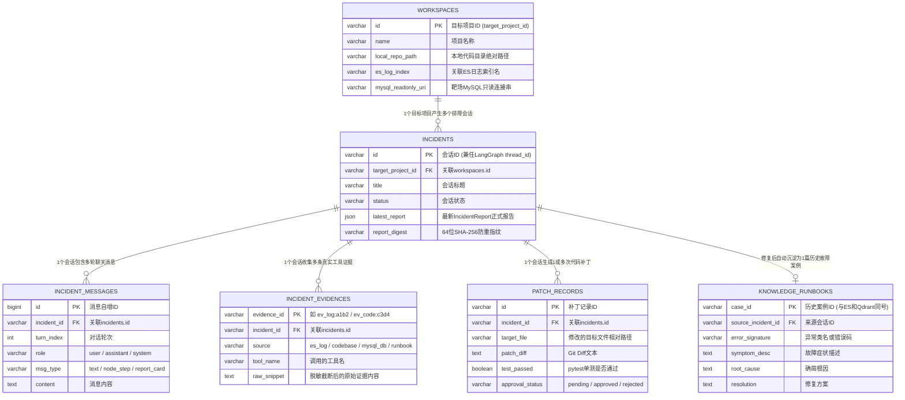

# 第 4 篇：多源数据库存储详细设计文档（MySQL / Elasticsearch / Qdrant / Redis）

> **文档说明**：本文档详细定义项目使用的 **4 类存储引擎（MySQL、Elasticsearch、Qdrant、Redis）** 的职责边界、ER 实体关系图、完整建表 SQL（DDL）、索引 Mapping 结构、以及每一个字段的具体工程用途。

---

## 一、 四大存储引擎职责分工总览

在面试和毕设答辩中，面试官/评委必问：**“你为什么同时用了 MySQL、ES、Qdrant 和 Redis？它们分别存什么？”**  
标准职责划分如下表：

| 存储引擎 | 存放的核心数据 | 为什么用它？（不可替代性） | 关联的图节点 / 探针 |
| :--- | :--- | :--- | :--- |
| **1. MySQL 8.0**<br>*(关系型主库)* | **① 平台管理库（6 张表）**：会话表、多轮消息表、证据账本表、补丁审批表、项目配置表、知识库主表<br>**② 故障靶场业务库（3 张表）**：商城用户表、优惠券表、订单表 | 强事务一致性（ACID）、结构化关联查询；同时靶场库供 **数据探针（NL2SQL）** 核查是否存在业务脏数据 | 主图持久化 &<br>`Worker C (数据探针)` |
| **2. Elasticsearch**<br>*(全文检索引擎)* | **① `mall-runtime-logs`**：被监控系统的实时运行报错堆栈与 `trace_id` 全链路日志<br>**② `historical-incidents-bm25`**：历史故障复盘库的关键词索引 | 毫秒级倒排索引，对**异常类名（`TypeError`）、错误码、文件路径、TraceID** 的字面精准匹配（BM25）远强于向量库 | `Worker A (日志探针)` &<br>`CRAG 子图 (BM25 路)` |
| **3. Qdrant**<br>*(向量数据库)* | **`historical_incidents_vec`**：历史故障症状、根因与解决方案的 Embedding 稠密向量 + Payload | 当用户只提供口语化现象（如*“黄金会员买东西没打折”*，无任何错误码）时，靠**语义相似度**召回同类历史故障 | `CRAG 子图 (Vector 路)` &<br>`apply_and_evolve 节点` |
| **4. Redis**<br>*(内存数据库)* | **① LangGraph `Checkpointer`**：各 `thread_id` 的图节点状态快照<br>**② 会话运行锁**：防止同一 `incident_id` 并发重入 | 亚毫秒级读写，原生支撑 LangGraph 的 `interrupt()` 人工审批挂起、断点恢复与多轮对话状态读取 | 全局 `StateGraph` 持久化 |

---

## 二、 MySQL 数据库表结构详细设计（含平台库 6 张表 + 靶场库 3 张表）

### 1. 平台核心表 ER 实体关系图



---

### 2. 平台库 6 张核心表 DDL 与字段用法详解（库名：`rca_platform_db`）

#### 表 1：`workspaces`（被监控靶场项目配置表）
```sql
CREATE TABLE `workspaces` (
    `id` VARCHAR(64) NOT NULL COMMENT '目标项目唯一标识 (target_project_id)，如 mall_demo',
    `name` VARCHAR(128) NOT NULL COMMENT '项目显示名称，如 微商城订单后端服务',
    `local_repo_path` VARCHAR(500) NOT NULL COMMENT '本地代码库根目录绝对路径，供 ls/grep/read_file 读取',
    `es_log_index` VARCHAR(128) NOT NULL COMMENT '该项目在 ES 中的运行日志索引名，如 mall-runtime-logs',
    `mysql_readonly_uri` VARCHAR(500) NOT NULL COMMENT '该项目业务数据库的只读连接串，供数据探针执行 SELECT',
    `default_test_cmd` VARCHAR(255) NOT NULL DEFAULT 'pytest' COMMENT '沙箱默认执行的单元测试命令',
    `repo_map_cache` MEDIUMTEXT NULL COMMENT '基于 tree-sitter 预生成的目录与类/函数签名拓扑树缓存',
    `created_at` DATETIME NOT NULL DEFAULT CURRENT_TIMESTAMP,
    `updated_at` DATETIME NOT NULL DEFAULT CURRENT_TIMESTAMP ON UPDATE CURRENT_TIMESTAMP,
    PRIMARY KEY (`id`)
) ENGINE=InnoDB DEFAULT CHARSET=utf8mb4 COMMENT='被监控目标项目与多源探针连接配置表';
```
* **关键字段用法**：
  * `local_repo_path`：代码探针子图执行文件读取时的安全沙箱根目录（所有相对路径拼接此目录，并校验禁止越界）。
  * `mysql_readonly_uri`：数据探针子图连接被排查项目数据库的地址。

---

#### 表 2：`incidents`（排障会话主表）
```sql
CREATE TABLE `incidents` (
    `id` VARCHAR(64) NOT NULL COMMENT '排障会话ID (如 inc_20261104_001)，直接作为 LangGraph 的 thread_id',
    `target_project_id` VARCHAR(64) NOT NULL COMMENT '关联被排查的目标项目ID (workspaces.id)',
    `title` VARCHAR(255) NOT NULL COMMENT '排障会话标题，由首轮提问自动提炼',
    `trigger_source` VARCHAR(32) NOT NULL DEFAULT 'manual_chat' COMMENT '触发来源: manual_chat(人工提问) / webhook_alert(告警触发)',
    `status` VARCHAR(32) NOT NULL DEFAULT 'investigating' COMMENT '状态: investigating(排查中) / need_info(待用户补充线索) / waiting_approval(待人工审批补丁) / resolved(已修复) / inconclusive(未查明)',
    `latest_report` JSON NULL COMMENT '最新一轮通过 valid_refs 防幻觉校验的 IncidentReport 完整 JSON',
    `report_digest` VARCHAR(64) NULL COMMENT '最新报告核心结论的 SHA-256 指纹 (fingerprint)，用于幂等查重',
    `created_at` DATETIME NOT NULL DEFAULT CURRENT_TIMESTAMP,
    `updated_at` DATETIME NOT NULL DEFAULT CURRENT_TIMESTAMP ON UPDATE CURRENT_TIMESTAMP,
    PRIMARY KEY (`id`),
    KEY `idx_project_status` (`target_project_id`, `status`)
) ENGINE=InnoDB DEFAULT CHARSET=utf8mb4 COMMENT='故障排障会话主表';
```
* **关键字段用法**：
  * `id`：整个系统的核心纽带。前端 URL 传它、查聊天记录传它、去 Redis 唤醒 `interrupt()` 断点也传它。
  * `status`：控制前端页面右上角的状态徽章，以及是否弹出【批准/驳回】按钮（当 `status = 'waiting_approval'` 时显示审批按钮）。

---

#### 表 3：`incident_messages`（会话多轮消息历史表）
```sql
CREATE TABLE `incident_messages` (
    `id` BIGINT NOT NULL AUTO_INCREMENT COMMENT '消息自增主键',
    `incident_id` VARCHAR(64) NOT NULL COMMENT '所属排障会话ID (关联 incidents.id)',
    `turn_index` INT NOT NULL DEFAULT 1 COMMENT '对话轮次序号 (第1轮提问、第2轮追问/审批反馈)',
    `role` VARCHAR(32) NOT NULL COMMENT '角色: user(工程师) / assistant(Agent) / system(节点进度通知)',
    `msg_type` VARCHAR(32) NOT NULL DEFAULT 'text' COMMENT '消息渲染类型: text(普通文本) / node_step(节点流转状态) / report_card(结构化报告卡片) / patch_approval(代码Diff审批卡片)',
    `content` MEDIUMTEXT NOT NULL COMMENT '消息正文内容',
    `metadata_json` JSON NULL COMMENT '扩展元数据，如引用的 evidence_ids、当前激活的节点名、耗时等',
    `created_at` DATETIME NOT NULL DEFAULT CURRENT_TIMESTAMP,
    PRIMARY KEY (`id`),
    KEY `idx_incident_turn` (`incident_id`, `turn_index`)
) ENGINE=InnoDB DEFAULT CHARSET=utf8mb4 COMMENT='排障会话多轮对话与事件流记录表';
```
* **关键字段用法**：
  * `msg_type`：前端 Vue3 聊天窗口根据这个字段决定怎么渲染气泡——如果是 `text` 就渲染普通 Markdown 对话；如果是 `report_card` 就渲染带折叠证据角标的排障报告组件；如果是 `patch_approval` 就渲染 Monaco Diff 代码对比框和审批按钮。

---

#### 表 4：`incident_evidences`（真实证据账本明细表）
```sql
CREATE TABLE `incident_evidences` (
    `evidence_id` VARCHAR(64) NOT NULL COMMENT '系统自动签发的唯一证据编号，如 ev_log:8f3a1c, ev_code:9b2d01',
    `incident_id` VARCHAR(64) NOT NULL COMMENT '所属排障会话ID (关联 incidents.id)',
    `source` VARCHAR(32) NOT NULL COMMENT '证据来源: es_log / codebase / mysql_db / git_history / runbook',
    `tool_name` VARCHAR(64) NOT NULL COMMENT '采集该证据的工具函数名，如 read_file_window, execute_readonly_sql',
    `query_args` VARCHAR(1000) NOT NULL COMMENT '调用工具时的入参 JSON 字符串',
    `summary` VARCHAR(500) NOT NULL COMMENT '证据简短描述，如 Read app/services/order_service.py:45-80',
    `raw_snippet` MEDIUMTEXT NOT NULL COMMENT '经 redact_text() 脱敏且限长 (<=4000字符) 后的真实返回内容',
    `created_at` DATETIME NOT NULL DEFAULT CURRENT_TIMESTAMP,
    PRIMARY KEY (`evidence_id`),
    KEY `idx_incident_ev` (`incident_id`)
) ENGINE=InnoDB DEFAULT CHARSET=utf8mb4 COMMENT='工具层自动签发的真实证据白名单表';
```
* **关键字段用法**：
  * 当用户在前端看到报告里写着 `"订单服务第 64 行未判空 [ev_code:9b2d01]"`，鼠标点击 `[ev_code:9b2d01]` 角标时，前端就根据 `evidence_id` 展示这张表里的 `query_args` 和 `raw_snippet`（报错代码原文）。

---

#### 表 5：`patch_records`（代码补丁与沙箱自愈审批表）
```sql
CREATE TABLE `patch_records` (
    `id` VARCHAR(64) NOT NULL COMMENT '补丁记录ID，如 patch_20261104_01',
    `incident_id` VARCHAR(64) NOT NULL COMMENT '所属排障会话ID (关联 incidents.id)',
    `target_file` VARCHAR(500) NOT NULL COMMENT '被修改的源码文件相对路径',
    `patch_diff` MEDIUMTEXT NOT NULL COMMENT '沙箱 git diff 生成的标准代码修改对比文本',
    `test_command` VARCHAR(255) NOT NULL COMMENT '执行的单元测试命令，如 pytest tests/test_order.py',
    `test_passed` TINYINT(1) NOT NULL DEFAULT 0 COMMENT '沙箱单测是否通过: 1(通过) / 0(未通过)',
    `test_output` MEDIUMTEXT NULL COMMENT 'pytest 测试控制台输出日志或失败堆栈',
    `self_heal_retries` INT NOT NULL DEFAULT 0 COMMENT '沙箱内经历的报错自愈重改次数 (0~3)',
    `approval_status` VARCHAR(32) NOT NULL DEFAULT 'pending' COMMENT '人工审批状态: pending(待审批) / approved(已批准应用) / rejected(已驳回重改)',
    `human_feedback` VARCHAR(1000) NULL COMMENT '人工点击驳回时填写的修改指导意见',
    `created_at` DATETIME NOT NULL DEFAULT CURRENT_TIMESTAMP,
    `updated_at` DATETIME NOT NULL DEFAULT CURRENT_TIMESTAMP ON UPDATE CURRENT_TIMESTAMP,
    PRIMARY KEY (`id`),
    KEY `idx_incident_patch` (`incident_id`)
) ENGINE=InnoDB DEFAULT CHARSET=utf8mb4 COMMENT='代码修复补丁与沙箱单测自愈审批记录表';
```

---

#### 表 6：`historical_runbooks`（历史故障复盘知识库主表）
```sql
CREATE TABLE `historical_runbooks` (
    `case_id` VARCHAR(64) NOT NULL COMMENT '历史故障案例编号 (如 INC-2026-089)，与 ES 和 Qdrant 中的主键严格一致',
    `title` VARCHAR(255) NOT NULL COMMENT '故障案例标题',
    `error_signature` VARCHAR(255) NULL COMMENT '特征异常类名或报错码，如 TypeError, ConnectTimeoutError',
    `api_or_module` VARCHAR(255) NULL COMMENT '关联接口路由或模块文件名，如 /api/orders/checkout',
    `symptom_desc` TEXT NOT NULL COMMENT '故障表面症状描述',
    `root_cause` TEXT NOT NULL COMMENT '经验证的确凿根因',
    `resolution` TEXT NOT NULL COMMENT '标准修复方案或代码修改说明',
    `source_incident_id` VARCHAR(64) NULL COMMENT '若由 AI 排障后自动沉淀生成，记录来源会话ID',
    `created_at` DATETIME NOT NULL DEFAULT CURRENT_TIMESTAMP,
    PRIMARY KEY (`case_id`),
    KEY `idx_error_sig` (`error_signature`)
) ENGINE=InnoDB DEFAULT CHARSET=utf8mb4 COMMENT='历史故障复盘与运维手册知识库主表';
```

---

### 3. 被监控故障靶场业务库 3 张表 DDL（库名：`mall_target_db`）
> **作用**：这是为了跑通我们的《01_USE_CASES.md》剧本一和剧本二而准备的**被监控靶场数据库**。**Worker C（数据探针）** 调用 `execute_readonly_sql` 查的就是这 3 张表！

```sql
-- 靶场表 1: 商城用户表 (对应剧本二：核查用户 10086 的 vip_level 等级)
CREATE TABLE `mall_users` (
    `id` BIGINT NOT NULL PRIMARY KEY COMMENT '用户ID，如 10086',
    `username` VARCHAR(64) NOT NULL,
    `vip_level` INT NOT NULL DEFAULT 0 COMMENT '会员等级: 0普通, 1白银, 2黄金会员, 3钻石会员',
    `status` VARCHAR(32) NOT NULL DEFAULT 'ACTIVE'
) ENGINE=InnoDB DEFAULT CHARSET=utf8mb4;

-- 靶场表 2: 用户优惠券表 (对应剧本一：核查用户 10086 的折扣券 discount_amount 为 NULL)
CREATE TABLE `mall_coupons` (
    `id` BIGINT NOT NULL PRIMARY KEY COMMENT '优惠券ID',
    `user_id` BIGINT NOT NULL COMMENT '所属用户ID，如 10086',
    `coupon_type` VARCHAR(32) NOT NULL COMMENT '类型: FULL_REDUCE(满减券) / RATE(折扣券)',
    `discount_amount` DECIMAL(10, 2) NULL COMMENT '固定减免金额 (当 coupon_type=RATE 时此字段合法为 NULL!)',
    `discount_rate` DECIMAL(4, 2) NULL COMMENT '折扣率，如 0.80 表示8折 (当 coupon_type=FULL_REDUCE 时为 NULL)',
    `status` VARCHAR(32) NOT NULL DEFAULT 'UNUSED' COMMENT '状态: UNUSED / USED / EXPIRED'
) ENGINE=InnoDB DEFAULT CHARSET=utf8mb4;

-- 靶场表 3: 商城订单表
CREATE TABLE `mall_orders` (
    `id` BIGINT NOT NULL PRIMARY KEY,
    `user_id` BIGINT NOT NULL,
    `coupon_id` BIGINT NULL,
    `total_price` DECIMAL(10, 2) NOT NULL,
    `final_price` DECIMAL(10, 2) NOT NULL,
    `order_status` VARCHAR(32) NOT NULL,
    `created_at` DATETIME NOT NULL DEFAULT CURRENT_TIMESTAMP
) ENGINE=InnoDB DEFAULT CHARSET=utf8mb4;
```

---

## 三、 Elasticsearch 双索引详细设计

### 1. 索引 1：`mall-runtime-logs`（实时运行报错日志索引）
* **谁查它**：`Worker A（日志探针）` 调用的 `search_error_logs` 和 `get_trace_logs`。
* **索引 Mapping 定义**：
  ```json
  {
    "mappings": {
      "properties": {
        "timestamp":   { "type": "date" },
        "level":       { "type": "keyword" },
        "trace_id":    { "type": "keyword" },
        "user_id":     { "type": "keyword" },
        "api_path":    { "type": "keyword" },
        "file_path":   { "type": "keyword" },
        "line_number": { "type": "integer" },
        "error_type":  { "type": "keyword" },
        "message":     { "type": "text" },
        "stack_trace": { "type": "text" }
      }
    }
  }
  ```
* **为什么这样设字段类型**：
  * `trace_id`、`user_id`、`level`、`api_path`、`error_type` 设为 **`keyword`（精确词项，不分词）**：保证按 `user_id="10086"` 或 `trace_id="req-8821"` 过滤时毫秒级精准命中；
  * `message` 和 `stack_trace` 设为 **`text`（全文分词）**：支持按报错关键词模糊搜索。

### 2. 索引 2：`historical-incidents-bm25`（历史故障库 BM25 索引）
* **谁查它**：`CRAGSubState` 子图的 `hybrid_retrieve_node`（负责字面关键词召回那一路）。
* **索引 Mapping 定义**：
  ```json
  {
    "mappings": {
      "properties": {
        "case_id":         { "type": "keyword" },
        "title":           { "type": "text", "boost": 2.0 },
        "error_signature": { "type": "text", "boost": 3.0 },
        "api_or_module":   { "type": "keyword" },
        "symptom_desc":    { "type": "text" },
        "root_cause":      { "type": "text" },
        "resolution":      { "type": "text" }
      }
    }
  }
  ```
* **设计亮点（权重 Boost）**：给 `error_signature`（异常名）设了 `boost: 3.0` 权重加成，一旦当前故障包含相同的异常类名，在 ES 路直接排到最前面。

---

## 四、 Qdrant 向量集合详细设计

### 集合名称：`historical_incidents_vec`
* **谁查它**：`CRAGSubState` 子图的 `hybrid_retrieve_node`（负责语义相似度召回那一路）。
* **向量配置（Vector Params）**：
  * `size`: `1024`（若使用 `BAAI/bge-large-zh-v1.5` / 硅基流动 / 阿里云百炼 `text-embedding-v3`）或 `1536`（OpenAI）
  * `distance`: `Distance.COSINE`（余弦相似度）
* **向量化文本拼接模板（什么内容转成向量）**：
  在入库时，不要把大段代码转成向量，而是将以下三项拼成一段干净的语义文本进行 Embedding：
  ```python
  embedding_text = f"故障标题: {title}\n故障现象: {symptom_desc}\n根本原因: {root_cause}"
  ```
* **Payload（随向量存储的 JSON 元数据）**：
  ```json
  {
    "case_id": "INC-2026-089",
    "title": "促销高峰期短信网关超时限流",
    "error_signature": "ConnectTimeoutError",
    "api_or_module": "/api/notify/sms",
    "symptom_desc": "调用 /api/notify/sms 接口出现大量连接超时",
    "root_cause": "第三方网关限制 50 QPS，未开启本地异步削峰队列",
    "resolution": "在 config/settings.yaml 中将 sms_async_queue_enabled 设为 true"
  }
  ```
* **与 MySQL、ES 的三端同步关系**：
  同一个历史故障案例，在 MySQL（`knowledge_runbooks`）、ES（`historical-incidents-bm25`）和 Qdrant（`historical_incidents_vec`）中使用**完全相同的 `case_id`**，从而支持 RRF 算法直接按 `case_id` 对齐合并分数。

---

## 五、 Redis 存储设计

在项目中，Redis 主要承担两项职责：

1. **LangGraph 状态机断点持久化（`langgraph-checkpoint-redis`）**
   * 当图调用 `compile(checkpointer=redis_saver)` 后，每走完一个节点，自动以 `thread_id`（即 `incidents.id`）为 Key 保存 `IncidentMainState` 的序列化快照。
   * 当执行到 `human_approval_node` 的 `interrupt()` 时，状态冻结在 Redis 中；前端点击【批准】调用恢复接口时，直接通过 `thread_id` 从 Redis 恢复上下文继续执行。
2. **排障任务分布式互斥锁（防止连点重复运行）**
   * **Key 格式**：`rca:lock:incident:{incident_id}`（TTL 设为 `120` 秒）
   * **作用**：当某个排障会话正在后台跑图时，防止前端用户连续狂点发送按钮触发两个并发图实例互相踩踏状态。
