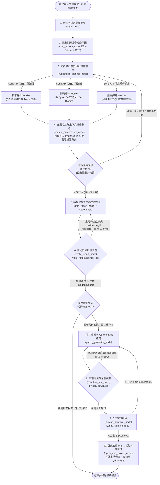

# 智能故障根因分析（RCA）与代码自愈 Agent —— 功能规格、完整运行流程与 LangGraph 图结构设计

> **文档说明**：本文档承接《GUIDE.md》，在你已读完 `open-swe` 核心文件（`report.md`、`models.py`、`report.py`、`runtime.py`、`remote_files.py`）的基础上，详细定义**你自己要实现的项目功能清单、端到端完整运行流程、以及 LangGraph 状态图拓扑与 State 设计**。

---

## 一、 项目核心功能模块清单（6 大核心模块）

本项目采用 **100% 纯 Python 后端（`LangGraph` + `FastAPI` + `SQLAlchemy` + `MCP` + `Tree-sitter`）+ `Vue3` 前端**，整体功能划分为以下 6 个模块：

### 模块 1：多模式故障接入与智能分诊（Incident Ingestion & Triage）
1. **三种故障输入模式**：
   * **模糊症状提问**：用户输入自然语言现象（如：“*刚才用户 10086 下单支付失败，提示系统异常*”）；
   * **监控告警 Webhook 触发**：接收接口错误率飙升或异常日志告警，自动创建排障工单（`Incident`）并启动后台自动调查；
   * **直接粘贴报错堆栈**：用户直接贴入一段 Traceback / 日志文本。
2. **线索提取与初步分诊（Triage）**：
   * 自动从输入中提取关键实体线索：`trace_id`、`user_id`、`order_id`、报错接口 URL（如 `/api/orders/create`）、异常时间窗口。
   * 复刻 `open-swe` 的幂等控制（`fingerprint` 指纹计算），避免相同告警重复触发无效排查。

### 模块 2：历史故障混合检索与经验自演进（CRAG & Self-Evolving Runbook）
1. **ES + Qdrant 双路混合检索（Hybrid Search）**：
   * **Elasticsearch (BM25)**：精准匹配报错码、异常类名（如 `KeyError`、`IntegrityError`）、接口路径；
   * **Qdrant (稠密向量)**：语义匹配故障症状描述；
   * **RRF（倒数秩融合）重排序**：合并两路结果，取 Top-K 历史故障单与运维手册（Runbook）。
2. **CRAG 检索相关性自省（Retrieval Grader）**：
   * 对检索出的历史故障进行评分：若命中高度一致的历史复发故障（Recurrence），直接提取当时的根因与修复方案，缩短 70% 排查路径（对应 `report.md` 第 2 步）。
3. **Post-mortem 经验自演进闭环**：
   * 每次故障修复经人工审批通过后，自动将本次的【故障现象 + 关键证据 + 根因 + 修复补丁】生成结构化复盘文档，切片写入 Qdrant 与 ES。

### 模块 3：多源证据探针工具集（MCP Toolsets）
所有工具调用返回结果均由外层收集器（`EvidenceCollector`）自动拦截，自动签发唯一 `evidence_id`（如 `ev_log:01`、`ev_code:02`、`ev_db:03`）存入真实证据池：
1. **日志探针（ES Log Probe）**：
   * `search_error_logs(keyword, trace_id, level, time_range)`：检索错误日志与完整调用堆栈；
   * `get_trace_context(trace_id)`：按请求链路 ID 拉取该次请求从入口到报错点的全链路上下文日志。
2. **本地代码库探针（Codebase ACI Probe，吸收 `open-swe` 与 `SWE-agent`）**：
   * 基于 `FILE_TOOLS` 原语实现：`ls`（列目录）、`glob`（找文件）、`grep`（搜代码关键字/路由 URL 并返回上下文行）、`read_file(file_path, offset, limit)`（带行号窗口分页读取源码）；
   * **进阶增强**：集成 `tree-sitter` 实现 `read_ast_function(file_path, line)`（自动根据报错行号提取完整函数体 AST 节点）与 `get_repo_map()`（生成项目类与方法签名拓扑树），以及 `git_blame_diff(file_path, start_line, end_line)`（查看报错代码近期 Git 修改记录）。
3. **数据库只读核验探针（Read-Only NL2SQL Probe，联动你已有的 NL2SQL 积累）**：
   * `inspect_table_schema(table_name)`：获取 MySQL 相关业务表结构；
   * `execute_readonly_sql(sql_query)`：强制校验仅允许 `SELECT` 语句（拦截 `UPDATE`/`DELETE`/`DROP`），用于核查报错时刻是否存在**数据库脏数据、字段空值或状态机异常**。

### 模块 4：假设驱动推理、上下文折叠与防幻觉拦截器（Core Reasoning Engine）
1. **多假设生成与并行求证（Hypothesis-Driven Map-Reduce）**：
   * 不允许大模型盲目乱搜，必须先输出 2~3 个结构化假设 `Hypothesis(title, assessment="plausible")`，再通过 LangGraph 的 `Send` API 并行派发探针取证。
2. **动态上下文折叠（Observation Masking）**：
   * 当某个假设被证伪（`assessment == "rejected"`）时，自动将该分支读取的几百行无关代码/日志从消息历史中折叠为一行简短摘要，仅保留当前有效证据，防止多步排查后 Token 爆炸。
3. **代码级防幻觉验钞机（复刻并升级 `open-swe` 的 `finalize_report`）**：
   * 大模型提交 `ReportDraft`（每个 `Claim` 绑定 `evidence_ids`）；
   * Python 节点执行 `valid_refs` 校验：检查 `evidence_ids` 是否非空且全部存在于 `collector.evidence` 真实白名单中；
   * **升级点**：若发现关键根因结论伪造证据 ID 或无证据支撑，一方面在 `gaps` 中记录警告，另一方面通过 LangGraph 条件边将其打回给 Agent 重新取证（最多打回 2 次）。

### 模块 5：Git Worktree 隔离沙箱自愈与人机协同审批（Self-Healing & HITL）
1. **代码补丁生成与隔离验证（Sandbox Self-Healing Loop）**：
   * 当根因确定为代码缺陷时，在临时 **Git Worktree 隔离目录** 中调用 `edit_file` 应用修改补丁；
   * 自动调用 `execute` 运行语法检查与关联 `pytest` 单元测试：若测试失败，捕获新的报错堆栈跳回修复节点自动修正（最多循环 3 次）。
2. **LangGraph `interrupt` 人工审批断点（Human-in-the-Loop）**：
   * 单测通过后，在真正合并回原代码文件和写入知识库前，触发 `interrupt()` 挂起当前图状态（由 Redis Checkpointer 持久化）；
   * 等待前端人工点击 **【批准应用补丁】** 或 **【驳回并输入修改意见】** 后，使用 `Command(resume=...)` 唤醒图完成最终写入。

### 模块 6：Vue3 可视化工作台与自动化基准评测集（Dashboard & Benchmark）
1. **FastAPI + Vue3 实时工作台**：
   * SSE 流式推送 LangGraph 当前激活节点、实时发现的 `Evidence` 卡片、`Hypothesis` 状态变化、结构化 `IncidentReport` 以及 Monaco 代码 Diff 审批界面。
2. **微商城故障靶场与评测脚本**：
   * 内置 20~25 个预设故障场景（涵盖空指针、脏数据、SQL 逻辑错误、配置错误等），一键跑批对比不同策略下的**根因定位准确率、证据引用准确率、平均 Token 消耗与排障耗时**。

---

## 二、 端到端完整运行流程（以一次真实排障为例）

下面用一个具体业务案例，完整演示系统从收到问题到修复归档的 **8 个执行阶段**：

> **场景设定**：被监控的靶场项目是一个 Python FastAPI 电商后端。  
> **用户输入**：*“刚刚用户 `user_id=10086` 反馈在结算页提交订单时一直报错 500，帮我查一下原因并修复。”*

### 阶段 1：入口分诊与线索初始化（`triage_node`）
1. **输入接收**：FastAPI 创建一条 `Incident` 工单，初始化后台证据账本 `EvidenceCollector`（此时 `known_ids = set()`）。
2. **提取线索**：`triage_node` 解析出关键检索词：`user_id="10086"`、业务模块=`"订单结算"`，并将初始状态写入 `IncidentState`。

### 阶段 2：历史故障库混合检索（`crag_history_node`）
1. **混合检索**：节点自动调用 `search_incidents` 去 **ES + Qdrant** 检索历史上是否有关于“订单结算 500”的故障记录。
2. **相关性判定（Grader）**：
   * *分支 A*：若发现上个月发生过一模一样的故障，将其录为证据 `ev_hist:01`，直接带着历史解决方案进入验证；
   * *分支 B（本例情况）*：历史库未命中同类故障，记录 `previous_occurrence = "已检索历史故障库，未发现同类复发记录"`，进入深度排查。

### 阶段 3：首次现场定位与多假设生成（`hypothesis_planner_node`）
1. **初步捞取错误日志**：Agent 先调用日志探针 `search_error_logs(keyword="10086", level="ERROR")`。
2. **工具返回并自动签发证据 ID**：
   * ES 返回了一条报错日志：`trace_id="req-8821"`, 接口 `POST /api/order/checkout`, 报错信息：`TypeError: unsupported operand type(s) for -: 'float' and 'NoneType' at app/services/order_service.py:64`。
   * `EvidenceCollector` 自动拦截该返回结果，生成第一条真实证据 **`ev_log:01`** 存入白名单！
3. **提出竞争性假设（`Hypothesis`）**：
   Agent 根据 `ev_log:01` 看到第 64 行发生了 `float - NoneType` 报错，生成 **2 个待验证假设**：
   * `Hypothesis 1`（代码探针方向）：`app/services/order_service.py` 第 64 行在计算优惠金额时，未对某个可能为 `None` 的变量做空值兜底；
   * `Hypothesis 2`（数据探针方向）：MySQL 数据库中用户 `10086` 使用的那张优惠券记录，其折扣金额字段（`discount_amount`）存在 `NULL` 脏数据。

### 阶段 4：多源探针并行取证与上下文折叠（`parallel_probe_workers`）
LangGraph 通过 **`Send` API** 同时启动代码探针与数据探针：
1. **代码探针分支（操作本地目录）**：
   * 调用 `read_file(file_path="app/services/order_service.py", offset=45, limit=35)` 读取第 64 行附近的完整函数代码：
     ```python
     62: coupon = await coupon_repo.get_by_id(db, dto.coupon_id)
     63: # 当优惠券为满减券且未设置固定抵扣额时，coupon.discount_amount 为 None
     64: final_price = total_price - coupon.discount_amount
     ```
   * 调用 `git_blame_diff("app/services/order_service.py", 60, 68)` 发现这行代码是昨天提交 `commit 7a3f12` 新增的。
   * 后台自动登记证据 **`ev_code:02`** 和 **`ev_git:03`**。
2. **数据探针分支（只读 NL2SQL 查 MySQL）**：
   * 调用 `execute_readonly_sql("SELECT id, coupon_type, discount_amount, rate FROM coupons WHERE user_id = 10086")`；
   * 查出用户 10086 持有的是一张“打折券（`coupon_type='RATE'`, `rate=0.8`）”，因此其固定减免字段 `discount_amount` 在数据库里合法为 `NULL`。
   * 后台自动登记证据 **`ev_db:04`**。
3. **更新假设状态与折叠无用上下文（`context_compressor_node`）**：
   * 综合代码与数据库证据，证实根因是：**代码第 64 行未区分“满减券（取 `discount_amount`）”与“折扣券（取 `rate`）”，直接用 `total_price - coupon.discount_amount` 导致遇到折扣券时必报 `NoneType` 错误**。
   * 将 `Hypothesis 1` 标记为 `supported`（绑定 `["ev_log:01", "ev_code:02", "ev_db:04"]`），折叠排查过程中查看过的无关目录列表，释放上下文窗口。

### 阶段 5：提交报告草稿与防幻觉硬校验（`draft_report_node` $\rightarrow$ `verify_report_node`）
1. **大模型提交 `ReportDraft`**：
   调用 `record_incident_report` 提交包含 `summary`、`problem`、`cause`、`next_steps`、`hypotheses` 的草稿，每个 `Claim` 均附带 `evidence_ids=["ev_log:01", "ev_code:02", "ev_db:04"]`。
2. **代码级防幻觉校验（`finalize_report`）**：
   * `verify_report_node` 执行 `valid_refs` 检查：核对所有引用的 ID 是否均在 `collector.evidence`（`{"ev_log:01", "ev_code:02", "ev_git:03", "ev_db:04"}`）中；
   * 若大模型胡编了 `ev_log:99`，节点将其拦截并通过条件边打回重填；校验全部通过后，生成正式的 **`IncidentReport`**，并计算 `fingerprint` 指纹存入数据库。

### 阶段 6：补丁生成与隔离沙箱单测自愈（`patch_and_test_node`）
1. **生成并应用补丁**：在临时 Git Worktree 中调用 `edit_file` 修改 `order_service.py:64`，增加对 `coupon_type == 'RATE'` 和 `None` 值的判断逻辑。
2. **自动运行单元测试**：调用 `execute("pytest tests/test_order_service.py")`。
   * 若单测失败 $\rightarrow$ 捕获报错日志，跳回 `patch_and_test_node` 自动修正代码（最多重试 3 次）；
   * 若单测通过 $\rightarrow$ 生成标准 Git Diff 文本，进入人工审批节点。

### 阶段 7：人工审批断点（`human_approval_node` - LangGraph `interrupt`）
1. 执行 `decision = interrupt({"report": incident_report, "diff": patch_diff, "test_result": "PASSED"})`，图执行暂停，状态保存在 Redis 中。
2. 前端 Vue3 页面弹出代码 Diff 对比框与“单测已通过”绿标，等待用户点击按钮：
   * 用户点击 **【批准修复】** $\rightarrow$ 前端调用恢复接口传入 `Command(resume={"action": "approve"})`。

### 阶段 8：正式写入与故障经验自演进（`apply_and_evolve_node`）
1. 将通过验证的代码补丁正式写入主工作区（或提交 Git 分支）。
2. 自动将本次生成的 `IncidentReport` 与修复 Diff 转化为 Markdown 复盘文档，向量化写入 **Qdrant** 与 **ES**，工单状态更新为 `completed`。

---

## 三、 LangGraph 状态图结构设计（Graph Topology & State）

### 1. 整体状态图拓扑结构（Mermaid 架构图）



---

### 2. 核心 State 与数据模型代码结构设计（可直接用于 `models/`）

在你的项目中，我们将 `open-swe` 的数据模型与 LangGraph 的 `TypedDict` / `BaseModel` 状态结合，定义如下：

```python
from typing import Annotated, Literal, TypedDict
import operator
from pydantic import BaseModel, Field
from langchain_core.messages import AnyMessage
from langgraph.graph.message import add_messages

# ==========================================
# 1. 吸收自 open-swe 的证据链与防幻觉报告模型
# ==========================================

class Evidence(BaseModel):
    """工具层自动生成的真实证据记录（大模型不可伪造）"""
    id: str                         # 唯一证据编号，如 "ev_log:01", "ev_code:02", "ev_db:03"
    source: Literal["es_log", "codebase", "mysql_db", "git_history", "runbook"]
    summary: str                    # 证据简述，如 "Read app/services/order_service.py:45-80"
    query: str                      # 触发该证据的工具调用参数 JSON
    raw_snippet: str                # 截取后的关键证据内容
    retrieved_at: str

class Claim(BaseModel):
    """大模型输出的每一条断言，强制要求绑定真实证据 ID"""
    text: str = Field(max_length=1200)
    evidence_ids: list[str] = Field(default_factory=list, max_length=10)

class Hypothesis(BaseModel):
    """排障假设及其验证状态"""
    id: str
    title: str                                                     # 假设内容
    probe_type: Literal["log", "code", "db"]                       # 需派发的探针类型
    assessment: Literal["supported", "plausible", "rejected"] = "plausible"
    evidence_ids: list[str] = Field(default_factory=list)          # 支撑或排除该假设的证据 ID

class ReportDraft(BaseModel):
    """给大模型填写的报告草稿 Schema (对应 open-swe ReportDraft)"""
    summary: list[Claim] = Field(default_factory=list)
    problem: list[Claim] = Field(default_factory=list)
    previous_occurrence: list[Claim] = Field(default_factory=list)
    impact: list[Claim] = Field(default_factory=list)
    cause: list[Claim] = Field(default_factory=list)
    next_steps: list[Claim] = Field(default_factory=list)
    hypotheses: list[Hypothesis] = Field(default_factory=list)
    gaps: list[str] = Field(default_factory=list)                  # 排查盲区（无需证据ID）
    questions: list[str] = Field(default_factory=list)             # 待向人类确认的问题（无需证据ID）

class IncidentReport(BaseModel):
    """经过 valid_refs 验钞过滤后生成的正式报告 (对应 open-swe IncidentReport)"""
    id: str
    summary: str
    problem: str
    previous_occurrence: str
    impact: str
    cause: str
    next_steps: list[str]
    outcome: Literal["inconclusive", "findings"]
    hypotheses: list[Hypothesis]
    evidence: list[Evidence]                                       # 完整真实证据列表
    gaps: list[str]
    questions: list[str]
    digest: str                                                    # fingerprint(digest_fields) 查重指纹
    created_at: str

# ==========================================
# 2. LangGraph 全局状态机 State 定义
# ==========================================

class IncidentAgentState(TypedDict):
    """LangGraph 主图在各个节点间流转的核心状态"""
    incident_id: str
    user_query: str                                                # 用户原始故障描述或告警内容
    extracted_clues: dict[str, str]                                # 提取出的 trace_id, user_id, url 等线索
    
    # 消息历史（支持通过 ContextCompressor 折叠已排除分支的冗长输出）
    messages: Annotated[list[AnyMessage], add_messages]
    
    # 历史故障 CRAG 检索结果
    historical_runbooks: list[dict]
    
    # 假设列表与真实证据账本（使用 operator.add 支持并行探针汇总证据）
    hypotheses: list[Hypothesis]
    evidence_ledger: Annotated[list[Evidence], operator.add]
    gaps: Annotated[list[str], operator.add]
    
    # 报告校验状态
    report_draft: ReportDraft | None
    final_report: IncidentReport | None
    hallucination_retry_count: int                                 # 防幻觉打回重试计数
    probe_loop_count: int                                          # 探针取证循环轮数
    
    # 代码补丁与沙箱自愈状态
    target_file: str | None
    patch_diff: str | None                                         # 生成的 Git Diff 补丁
    test_passed: bool
    test_error_output: str | None
    patch_retry_count: int                                         # 单测失败自愈重试计数
    
    # 人工审批结果 (HITL)
    human_approval: Literal["pending", "approved", "rejected"]
    human_feedback: str | None
```

---

### 3. 各节点（Nodes）输入输出职责速查表

| 节点编号与名称 | 核心输入状态字段 | 内部调用的核心工具 / 逻辑 | 更新输出的状态字段 |
| :--- | :--- | :--- | :--- |
| **1. `triage_node`** | `user_query` | 正则 + LLM 提取 `trace_id`/`user_id`/URL；生成RepoMap顶层视图 | `extracted_clues` |
| **2. `crag_history_node`** | `user_query`, `extracted_clues` | ES(BM25) + Qdrant(Vector) + RRF 重排 + Grader 相关性评分 | `historical_runbooks`, `evidence_ledger` |
| **3. `hypothesis_planner_node`** | `extracted_clues`, `historical_runbooks`, `evidence_ledger` | 分析当前已有线索，生成或更新 2~3 个 `Hypothesis`，通过 `Send` 分发探针 | `hypotheses`, `probe_loop_count` |
| **4. `probe_workers` (并行)** | 单个 `Hypothesis` | **Log**: `search_error_logs`<br>**Code**: `ls`/`grep`/`read_file`/`git_blame`<br>**DB**: `execute_readonly_sql` | 自动封装 `Evidence` 追加进 `evidence_ledger` |
| **5. `context_compressor_node`** | `messages`, `hypotheses`, `evidence_ledger` | 检查已证伪（`rejected`）的假设，折叠历史消息中的长文本代码/日志 | 压缩后的 `messages`, 更新后的 `hypotheses` |
| **6. `draft_report_node`** | `evidence_ledger`, `hypotheses` | 加载汉化版 `report.md` 提示词，调用 `StructuredTool` 生成 `ReportDraft` | `report_draft` |
| **7. `verify_report_node`** | `report_draft`, `evidence_ledger` | 执行 `finalize_report` 与 `valid_refs` 防幻觉验钞 + `fingerprint` 指纹计算 | `final_report` 或递增 `hallucination_retry_count` |
| **8. `patch_generator_node`** | `final_report`, `evidence_ledger` | 在临时 Git Worktree 中调用 `edit_file` 修改目标缺陷代码，生成 `git diff` | `target_file`, `patch_diff` |
| **9. `sandbox_test_node`** | `patch_diff` | 调用 `execute("pytest ...")` 或 `ast.parse` 语法检查 | `test_passed`, `test_error_output`, `patch_retry_count` |
| **10. `human_approval_node`** | `final_report`, `patch_diff`, `test_passed` | 调用 `langgraph.types.interrupt()` 挂起等待前端人工审批 | `human_approval`, `human_feedback` |
| **11. `apply_and_evolve_node`** | `patch_diff`, `final_report` | 将补丁正式写入仓库，并将本次 `IncidentReport` 向量化归档进 Qdrant & ES | 流程结束 (`END`) |
